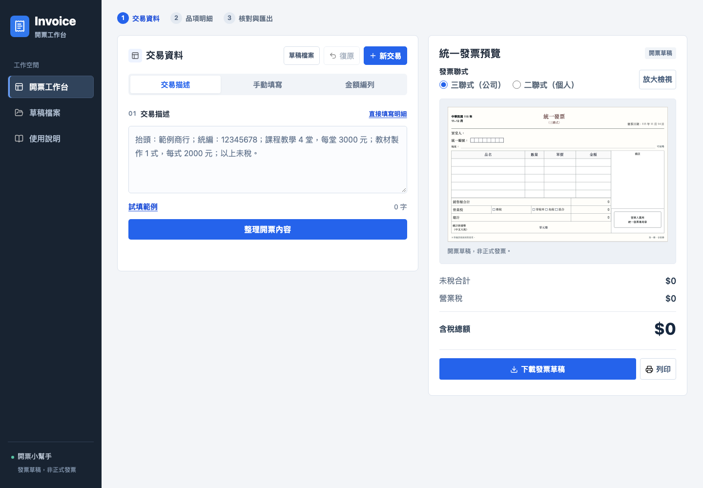

# 開票小幫手｜開票工作台

協助手開發票的線上工具：將交易描述整理成買受人資料、品項明細與金額試算，再以發票草稿呈現，方便核對後填寫紙本發票。

依照習慣選擇「交易描述」、「手動填寫」或「金額編列」，三種方式共用同一筆交易資料。桌機即時預覽，手機可切換至完整票面核對；不必先輸入內容，也能查看空白發票格式。

**[立即使用開票工作台](https://tsunghan1116-bot.github.io/invoice-helper/)**



## 新版工作區

- 深色側欄提供工作台、草稿檔案與使用說明；編輯區內選擇交易描述、手動填寫或金額編列。
- 上方流程只提示目前作業階段，不是需要依序點擊的精靈，也不會阻止直接修改。
- 新交易、復原與草稿檔案集中在編輯區標題旁，移除重複頁首與標題。
- 寬桌機並排編輯與預覽，較長內容在區塊內捲動；手機使用單欄與編輯／預覽切換，不強行縮小整張表格。
- 使用說明在站內視窗開啟，提供六個章節與七張實際操作圖；圖片也能在原視窗內放大。關閉後可繼續原本交易。

## 功能特色

| 功能 | 說明 |
| --- | --- |
| 三種填寫模式 | 編輯區的分頁會切換實際編輯內容，不只是跳到頁面下方；切換不清空資料、不重新解析，也不自動套用建議。 |
| 文字整理開票內容 | 辨識抬頭、統編、品名、數量與金額，支援分行描述及 `1200*4=4800` 等寫法。 |
| 含稅與未稅試算 | 確認價格類型後，自動更新品項小計、銷售額、營業稅及總計；提供應稅、零稅率與免稅設定。 |
| 空白與即時發票預覽 | 一開始就顯示空白發票，可切換三聯式／二聯式；填寫後同步更新金額與中文大寫總額。桌機可開啟 900px 票面視窗；手機可原位放大、捲動查看。 |
| 編列版本選擇 | 依已辨識的交易內容提供直列、合併或附交易說明的版本；可直接套用，也能復原上次套用。 |
| 目標金額編列 | 可輸入目標金額及服務類型，產生編列建議；使用前需確認符合實際交易。 |
| 買受人查詢 | 透過統編或公司名稱查詢公開資料，減少重複輸入；結果仍需人工核對。 |
| 草稿保存與輸出 | 支援草稿 JSON 檔匯出與載入、PNG 圖片下載及列印。 |
| 資料核對與復原 | 價格未明確時在明細下方詢問含稅／未稅；缺品名、金額或描述未整理時，指出問題欄位並阻擋誤下載。編輯區上方提供復原與新交易。 |
| 緊湊手機介面 | 減少頁首與欄位間距；預覽可放大，返回編輯時保留內容、模式與原本位置。 |
| 站內圖文使用說明 | 涵蓋文字整理、手動填寫、價格確認與修改、編列版本、預覽下載、備份與復原；不必切換分頁。 |

## 選擇填寫方式

| 模式 | 適合情境 | 操作方式 |
| --- | --- | --- |
| 交易描述 | 已有客戶訊息或交易文字 | 貼上文字、整理內容，再核對與修改辨識結果。 |
| 手動填寫 | 想直接填寫買受人與品項 | 填寫日期、品名、數量、單價並確認價格類型。 |
| 金額編列 | 需要選擇明細呈現方式，或只有目標總額 | 已整理的描述依原交易明細產生版本；沒有描述時可設定目標總額及服務類型。按「套用」才修改明細，產生建議本身不會覆蓋資料。 |

「草稿檔案」位於編輯區上方，也可從側欄開啟，可匯出備份或載入先前草稿。「新交易」才會重設目前交易；有未匯出修改時會先詢問。「復原」回復上次帶入或套用前的資料，不是每一次鍵盤輸入的歷史紀錄。

## 使用流程

1. 在編輯區選擇交易描述、手動填寫或金額編列。
2. 描述模式按「整理開票內容」；手動模式直接輸入。未註明含稅／未稅時再確認，不會自動沿用上一筆描述的價格設定。
3. 核對抬頭、統編、品名、數量、單價、稅別與日期；有疑義的內容仍需人工確認。
4. 桌機查看右側即時預覽；手機按「核對預覽」，也可在未填寫時先查看空白格式。
5. 確認內容後下載 PNG、列印或匯出草稿檔。預覽不代表資料已完整，待確認的資料仍會阻擋下載。

### 選錯含稅／未稅怎麼辦？

在品項下方展開「修改含稅／未稅」，選擇新類型後按「套用全部品項」。各筆價格類型不同時，請改用「更多設定 → 單價與稅別設定」逐筆核對。「含稅／未稅」與「應稅／零稅率／免稅」是不同設定。

### 圖片與草稿檔有什麼不同？

- **PNG**：供核對、分享與查看的圖片，不能用來還原編輯欄位。
- **JSON**：可再次載入工作台的草稿資料；需要日後繼續修改時，請另外保存。
- 畫面的淡紙色與陰影只作閱讀呈現，下載與列印維持清晰白底。
- 說明與票面視窗可按右上角關閉；說明圖片亦可返回說明。鍵盤 Esc 會先關閉目前的圖片視窗。

### 描述範例

以下皆為示範資料：

```text
週三範例社團
1200*4=4800

抬頭：範例國小
統編：12345678
名稱：115年10月社團鐘點費
以上未稅
```

此寫法會將「名稱」帶入品名，數量為 4、單價為 1,200。依工具預設 5% 應稅設定，試算為未稅 4,800、稅額 240、含稅 5,040。示範統編不代表真實或已驗證的買受人。

## 資料與使用限制

- **草稿不是正式發票**：本工具供試算與填寫核對，不會開立電子發票，也不會向財政部申報或傳送發票。
- **不是稅務合規判斷系統**：正式開立前，請依實際交易、紙本格式及適用規範確認；不確定的稅務處理應另行諮詢專業人員。
- **文字辨識採本機規則解析**：不是通用 AI，無法保證理解所有自由敘述；遇到缺漏、算式不一致或待確認資料，請人工核對。
- **編列不等於新增交易**：版本與金額建議僅協助整理，不能用來創造不存在的品項、數量或交易。
- **目標總額方案需核對實際項目**：依服務類型產生的品名屬建議，不代表交易事實；套用前請核對並修改。
- **目前沒有雲端開票紀錄資料庫**：不提供帳號、多人共用或跨裝置自動同步；重要草稿請自行匯出保存。
- **公開資料查詢需要網路**：查詢會向外部服務送出查詢用的統編或公司名稱；結果與可用性取決於資料來源。
- 草稿檔及下載圖片可能含有買受人資訊，分享或備份前請確認內容與存放位置。

## 本機使用與檢查

下載完整專案後，可直接以瀏覽器開啟 `index.html`。請保留同目錄的 JavaScript、CSS 及 `assets` 資料夾。

若已安裝 Node.js，可執行以下檢查：

```sh
node transaction-parser.test.cjs
node --check script.js
node --check draft-workflow.js
node --check workspace-modes.js
node --check workspace-preview.js
node --check workspace-guide.js
```

已以 Chromium 測試原有 11 組操作流程，並檢查 8 種寬度的模式切換、欄位邊界、價格確認、草稿匯入／匯出與圖片下載；另檢查票面放大、說明圖片視窗與關閉後資料保留。模擬測試不等於實機、Safari 或實際列印驗收。

新版入口為 `index.html`，`workspace-preview.html` 保留相同介面作相容入口；[舊版入口](https://tsunghan1116-bot.github.io/invoice-helper/index-classic.html)保留以供對照。使用說明與圖片需一併保留，請勿只下載單一 HTML。

## 使用元件

- [html-to-image](https://github.com/bubkoo/html-to-image)：發票草稿 PNG 匯出。
- [Lucide](https://lucide.dev/)：介面圖示。
